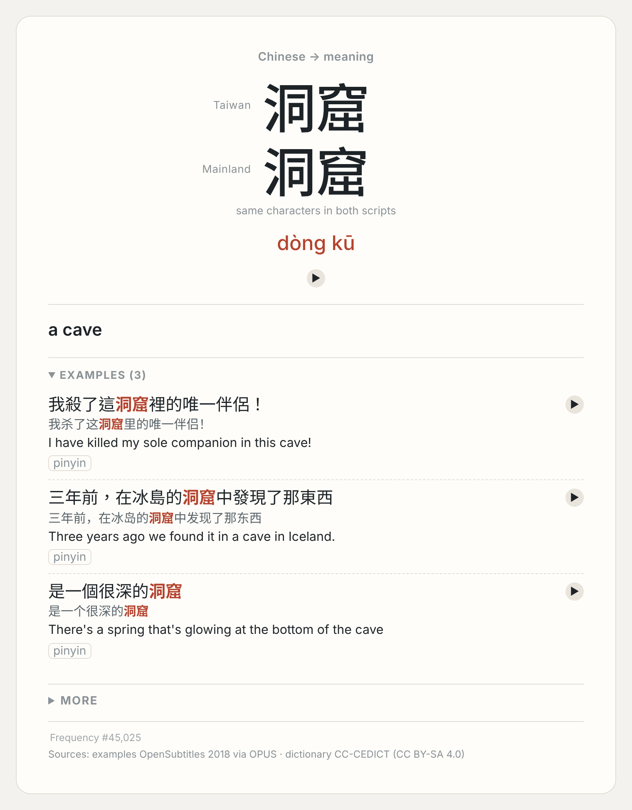
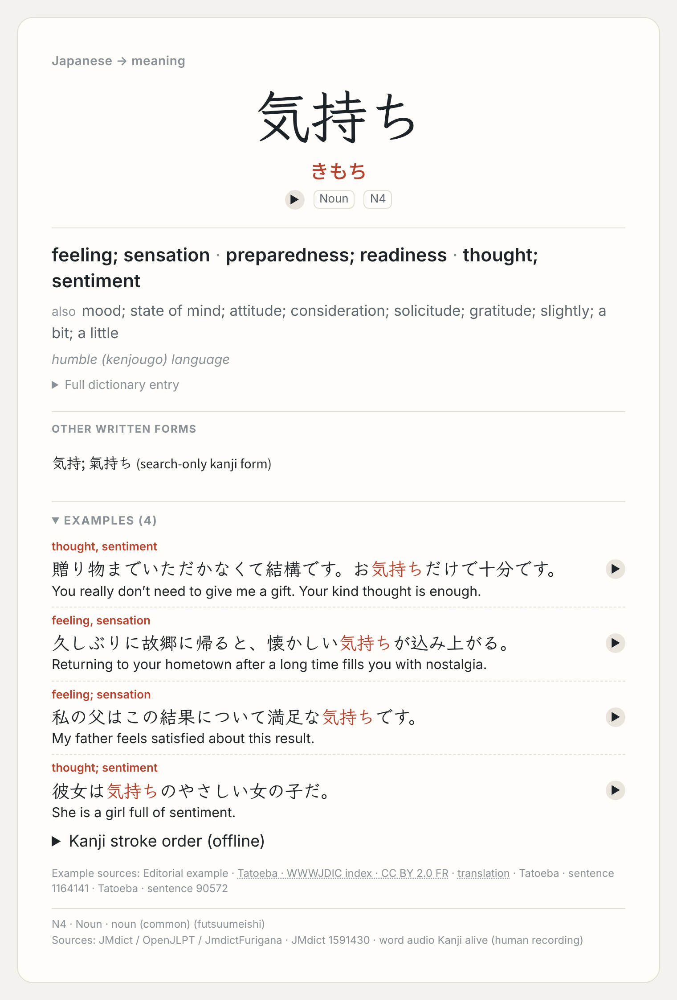
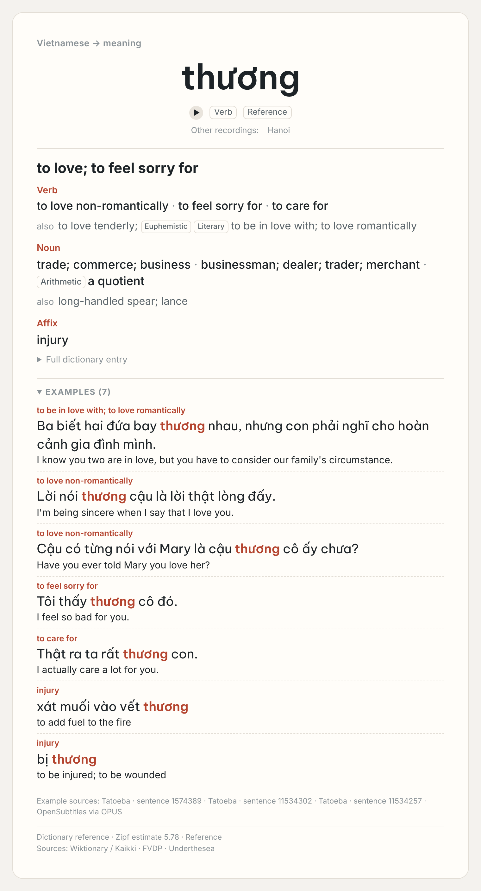
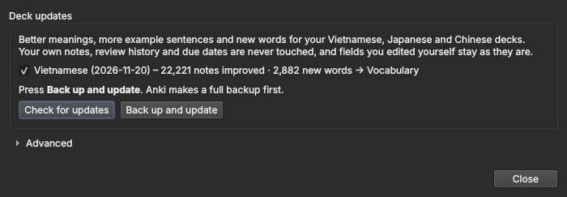

# Card Redesign for Anki

One clean, consistent card layout for three large vocabulary decks — Chinese (CC-CEDICT), Japanese (JMdict)
and Vietnamese (v8) — plus a safe **deck updater** that brings in better meanings, more example sentences and
new words without touching your own notes or your learning progress.

| Chinese | Japanese | Vietnamese |
|---|---|---|
|  |  |  |

## What the layout does

- The script asked on the front stays on top of the back. Chinese shows Taiwan and Mainland forms together
  (traditional first on the production card), Japanese shows kanji with the reading, Vietnamese the word with
  its part of speech.
- The main meanings come first, in the order they are actually used; rarer senses are folded under *also*.
- Up to three example sentences, each labelled with the meaning it shows, the word highlighted, audio
  (text-to-speech) per sentence and, for Chinese, pinyin behind a button. More examples are folded.
- Your own notes and mnemonics, then one *More* fold with spellings, stroke order, recordings, links and sources.
- Same fields and card types as before, so applying it never forces a full sync.

Design notes: [docs/design.md](docs/design.md) · per-language plans: [Chinese](docs/plan-chinese.md),
[Japanese & Vietnamese](docs/plan-jp-vn.md).

## The dialog



*Tools › Card redesign…*

1. **Check for updates** – looks at the newest release of
   [anki-language-decks](https://github.com/0Duc0/anki-language-decks/releases/latest) and downloads the
   update for each language you have (nothing else). It compares the update with your notes and shows what
   would change. Nothing is written.
2. **Back up and update** – Anki makes a full backup first. Then, per language, the card layout is installed
   if it isn't current yet, the fields are updated and new words are added.

New words go to the deck the update names; if your decks are named differently (e.g. *Tiếng Việt* instead of
*Vietnamese*), the deck with the same ending is used (e.g. *…::99 Dictionary Reference*), otherwise the deck
that holds most of that language's cards. Hover over a language to see the deck.

**Advanced** holds *Update from a file…* (for an update file you downloaded yourself, with *Undo an update…*)
and the card-layout tools (*Dry run*, *Back up and apply*, *Restore old layout*).

### Why the updater is safe

- Notes are matched by their GUID (with the word as a fallback), so renamed decks or moved notes are found.
- Every changed field carries a fingerprint (SHA-1) of the content the update was made from. If you edited the
  field since, it does not match and **your version is kept**.
- Personal fields (`PersonalNotes`, `Notizen`, `Mnemonic`, `UserMnemonic`, `Eigene_Merkhilfe`) are never written.
- Review history, due dates, intervals, flags, tags and the deck of existing cards stay as they are.
- New words get stable GUIDs: applying the same update twice adds nothing, and a later update recognises them.
- The undo file is written while the update runs, so even an interrupted update can be undone. Undo keeps
  fields you changed afterwards and new words you have already studied.

Tested at full size on copies of the real collections: 22,221 Vietnamese notes and 2,882 new words in about
15 seconds; schedule unchanged, database integrity check clean, undo returns exactly the original.

## Install

Download `card_redesign-<version>.ankiaddon` from the [latest release](../../releases/latest), double-click it
(or *Tools › Add-ons › Install from file…*) and restart Anki. Requires Anki 25.09 or newer.

## Development

```
pip install anki aqt pytest beautifulsoup4
python -m pytest tests            # 114 tests; fixtures in tests/fixtures.zip
python -I tools/package.py dist/card_redesign-2.0.0.ankiaddon
```

| Path | |
|---|---|
| `card_redesign/cn.py`, `jp.py`, `vn.py` | per-language note cleaning |
| `card_redesign/*_templates.py`, `templates/` | card templates and CSS |
| `card_redesign/updater.py` | deck update: plan, apply, undo |
| `card_redesign/ui.py` | the Tools dialog |
| `card_redesign/fonts/` | bundled fonts (SIL Open Font License, see the OFL files) |
| `tools/render.py`, `tools/corpus_check.py` | render cards to HTML / check example corpora |

## License

Personal project, no license granted. Bundled fonts keep their SIL Open Font License (`card_redesign/fonts/OFL-*.txt`).
